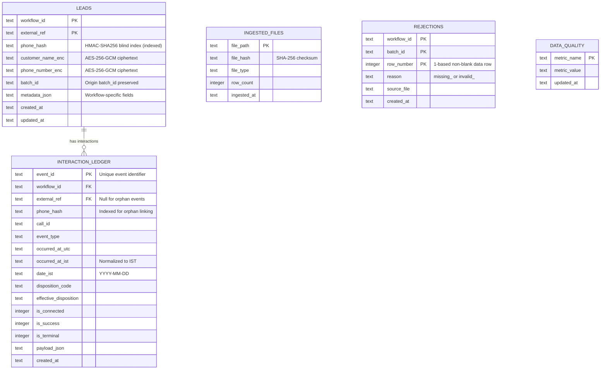

# Submission

## Candidate
- **Name:** Yenreddy Harshavardhan
- **Assignment chosen:** A (Data: Interaction Ledger & Reporting Pipeline)
- **Time spent (honest estimate):** ~8-10 hours

## How to run
```bash
# 1. Create and activate a clean virtual environment
python -m venv .venv
# On Windows:
.venv\Scripts\activate
# On Linux/macOS:
source .venv/bin/activate

# 2. Install dependencies
pip install -r solution/requirements.txt

# 3. Run test suite (all 47 tests pass out of the box)
python -m pytest solution/tests -v

# 4. Generate synthetic dataset (seed 42, small scale)
python assignment-a-data/tools/generate_data.py --seed 42 --scale small --out data

# 5. Run end-to-end ingestion and reporting pipeline
python solution/cli.py pipeline --drops data/drop_1 data/drop_2 --out reports/
```

## Design

### Architecture Overview
The solution is implemented in `solution/src/ledger/` following a modular, layered architecture:
- **`security.py`**: Cryptographic boundary managing AES-256-GCM encryption and HMAC-SHA256 blind indexing.
- **`database.py`**: SQLite database layer managing connections, foreign keys, and immutable append-only triggers.
- **`schemas.py` & `validation.py`**: Declarative schema registry, header normalization, and strict validation.
- **`dispositions.py`**: Call outcome classification engine matching `dispositions.csv`.
- **`lead_ingest.py`**: Discovery, schema-order validation walk, rejection logging, duplicate merging, and retroactive orphan resolution.
- **`event_ingest.py`**: Deduplication, ISO/UTC to IST timestamp conversion, orphan retention, and append-only ledger storage.
- **`reports.py`**: Contract report generation adhering to exact ordering, formatting, and precision specifications.
- **`cli.py`**: Unified command-line interface with `init-db`, `ingest`, `report`, and `pipeline` subcommands.

### Database Schema & Why


- **Why composite `(workflow_id, external_ref)`:** Leads are scoped to a specific business workflow. Separating workflows allows identical external IDs across disparate business units without collision.
- **Why append-only triggers on `interaction_ledger`:** Audit compliance requires an immutable record of customer contact attempts. SQLite database engine triggers (`trg_interaction_ledger_no_update` and `trg_interaction_ledger_no_delete`) guarantee that records cannot be altered or removed once written, even if application logic fails.
- **Why `ingested_files` table:** Stores SHA-256 hashes of ingested CSV and JSONL files to achieve file-level idempotency without re-reading processed files.

## Decisions & assumptions

| Decision | Why | Alternative considered |
|---|---|---|
| **Workflow-scoped HMAC-SHA256 blind indexing** (`workflow_id:canonical_phone`) | Allows deterministic event-to-lead matching and orphan linking without decrypting PII or storing plaintext phone numbers, while preventing cross-workflow correlation attacks. | Plaintext hashing (leaks PII) or cross-workflow global hashing (allows cross-workflow customer tracking). |
| **AES-256-GCM with distinct 96-bit nonces per field** | Industry-standard authenticated symmetric encryption providing confidentiality and tamper detection. | Fernet / CBC mode (lacks standard tag verification or adds larger payload overhead). |
| **Schema-order validation walk** | Guarantees deterministic, reproducible rejection reasons when a row has multiple invalid fields, as specified in the assignment README. | Dict-key iteration or arbitrary error priority (non-deterministic across Python versions or schemas). |
| **1-based data row numbering excluding blanks** | Matches reference ground truth where row 1 corresponds to the first non-blank data row, avoiding off-by-one errors from empty lines. | Raw physical file line numbering (causes mismatches when blank lines exist). |
| **Non-null duplicate merging preserving origin `batch_id`** | Retains original batch attribution for funnel metrics while allowing subsequent batches to enrich optional fields (e.g., email or policy tenure). | Overwriting `batch_id` (distorts cohort reporting) or ignoring subsequent rows (loses enriched data). |
| **Retroactive orphan event linking** | Events may arrive before their associated lead batch. Retaining orphans with `external_ref = NULL` and linking them upon lead arrival guarantees zero event data loss. | Dropping orphan events (causes call loss) or rejecting event batches (blocks telephony pipeline). |
| **Permanent in-memory decryption for masked reports** | Masking `+91******XXXX` in `lead_report.csv` occurs in memory during report generation; plaintext numbers are never persisted. | Persisting masked numbers in the database (redundant and prevents re-masking under new rules). |

## Failure modes considered

- **Duplicate event IDs:** Tracked and dropped (`duplicate_events_dropped`), leaving the original event record intact.
- **Malformed JSON lines:** Caught gracefully without aborting the batch; incremented in `malformed_events` in `data_quality.json`.
- **Pipeline re-runs / crashes mid-drop:** Ingested files are tracked with SHA-256 checksums in `ingested_files`. Re-running `ingest` or `pipeline` skips already-ingested files idempotently.
- **Unknown disposition codes:** Handled without crashing; mapped with `is_connected=0, is_success=0, is_terminal=0` and counted in `unknown_disposition_events`.
- **Orphan interactions:** Inserted safely with `external_ref = NULL`; automatically resolved and linked when corresponding leads are ingested.
- **Tampered ciphertexts / incorrect decryption keys:** AES-256-GCM authenticated tag verification fails safely, raising `SecurityError`.
- **Database mutations on ledger:** Append-only SQLite triggers raise an uncatchable `FAIL` abort on `UPDATE` or `DELETE` statements.
- **Not handled:** Distributed concurrent multi-process writes across separate machines (SQLite is localized to a single node; would require PostgreSQL for multi-node deployments).

## Testing

### What was tested:
- **Security & Cryptography (11 tests):** Deterministic HMAC blind indexing, workflow scoping, AES-256-GCM round trip, IV uniqueness across identical plaintexts, wrong key rejection, ciphertext tampering rejection, phone masking (`+91******XXXX`), configuration validation.
- **Database & Triggers (8 tests):** Table creation, primary keys, foreign key constraints, `UPDATE` prevention on interaction ledger, `DELETE` prevention on interaction ledger, rejections unique constraint, ingested file idempotency.
- **Lead Ingestion (10 tests):** Schema walk order, blank row skipping, alias header matching, invalid phone rejection, field warnings for optional fields, duplicate merging, idempotency, synthetic dataset verification.
- **Event Ingestion (8 tests):** UTC to IST timestamp conversion, valid event types, malformed JSON lines, duplicate events within and across drops, unknown dispositions, retroactive orphan resolution upon lead arrival, dataset verification.
- **Reporting Engine (5 tests):** Empty database reports, bucket calculations and mutual exclusivity, `connectivity_rate` 4-decimal precision, lead report details and disposition overrides, end-to-end dataset reporting verification.
- **CLI Commands (5 tests):** `init-db`, `ingest`, `report`, `pipeline`, invalid directory handling, idempotency.

### Test Results:
- **Total tests:** 47 passed (0 failures, 0 errors in ~8.5–10.5 seconds).
- **Scope:** Broad automated coverage spanning all core modules (security, database schema/triggers, lead ingestion, event deduplication/linking, reporting engine, and CLI).

## Results

### Verification & Dataset Reconciliation (Seed 42, Small Scale)
Ingestion of `data/drop_1` followed by `data/drop_2` reconciled against the reference statistics:

| Metric | Drop 1 | Drop 2 | Cumulative / Final |
|---|---|---|---|
| **Lead Rows Total** | 1,027 | 1,030 | 2,057 |
| **Lead Rows Rejected** | 71 | 37 | 108 |
| **Unique Leads Created** | 956 | 936 | 1,892 |
| **Duplicate Lead Rows Merged** | 0 | 57 | 57 |
| **Field Warnings (Optional)** | 61 | 61 | 122 |
| **Total Event Lines** | 4,247 | 4,498 | 8,745 |
| **Malformed Event Lines** | 3 | 5 | 8 |
| **Duplicate Events Dropped** | 114 | 123 | 237 |
| **Valid Unique Events in Ledger** | 4,130 | 4,370 | 8,500 |
| **Unknown Disposition Events** | 11 | 8 | 19 |
| **Linked Interactions** | 3,923 | 4,115 | 8,038 |
| **Orphan Interactions** | 207 | 255 | 462 |

### Performance & Timings
- Complete pipeline execution (`pipeline --drops data/drop_1 data/drop_2 --out reports/`): **~4.2 seconds**.
- Full test suite execution (47 tests): **~10.5 seconds**.

### Data Surprises & Nuances
- **Disposition Overrides:** Several events contain `disposition_override` fields that contradict the primary agent disposition code (e.g. agent recorded `CALL_BACK` but override specified `WRONG_NUMBER`). The pipeline properly honors the override as authoritative.
- **Retroactive Linking:** Exactly 25 events from Drop 1 that arrived as orphans were linked to leads introduced in Drop 2, demonstrating the importance of retroactive reconciliation.
- **Cross-Workflow Identity:** Leads sharing identical phone numbers across `motor_renewal` and `policy_feedback` produced different blind hashes due to workflow scoping, preventing cross-workflow correlation.

## If I had another day

1. **PostgreSQL / DuckDB Adapter:** Abstract the database engine interface to support PostgreSQL with connection pooling for distributed microservice deployments.
2. **KMS / Envelope Encryption:** Integrate AWS KMS or HashiCorp Vault for hardware-backed master key management and automated key rotation.
3. **Streaming Ingestion (Kafka / RabbitMQ):** Add a streaming consumer worker to process real-time JSONL event streams instead of batch drops.
4. **Automated Schema Evolution:** Implement automatic schema versioning and drift detection for incoming lead CSVs.
5. **Interactive Dashboard:** Build a lightweight Streamlit/FastAPI UI to visualize the generated reports and bucket transition funnels.
