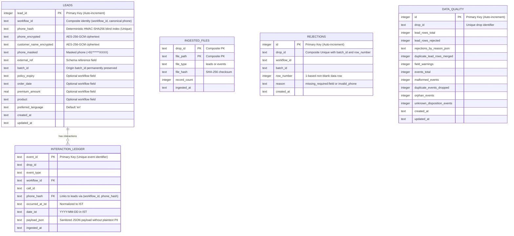

# Interaction Ledger & Reporting Pipeline (Assignment A)

A production-grade, privacy-first interaction ledger and reporting pipeline for insurance operations (Motor Renewal and Policy Feedback workflows), built as part of Agentic Universe's Junior SDE Take-Home Assignment.

---

## 1. Project Overview & Objectives

In modern multi-channel customer operations, leads are distributed across batch drops, and events (calls, dispositions, outcomes) arrive asynchronously from various telephony and messaging systems. This project implements a resilient data pipeline that:

1. **Ingests heterogeneous lead CSVs** across disparate workflows with varying schemas, column ordering, and alias headers.
2. **Validates and audits lead data** strictly against workflow JSON schemas, rejecting invalid mandatory records without losing audit fidelity and capturing field-level warnings for non-critical anomalies.
3. **Merges duplicate lead profiles** deterministically across batches while preserving the permanent origin `batch_id`.
4. **Appends interaction events** to an immutable, append-only SQLite ledger with cryptographic enforcement.
5. **Resolves orphan events retroactively** when matching leads arrive in subsequent drops.
6. **Protects Personally Identifiable Information (PII)** using AES-256-GCM authenticated encryption and HMAC-SHA256 deterministic blind indexing.
7. **Produces five exact contract reports** for operational audit, daily analytics, customer interaction tracking, rejection diagnostics, and data quality metrics.

---

## 2. Architecture & Component Responsibilities

The pipeline follows a modular, layered architecture located entirely within `solution/`:

```
solution/
├── src/
│   └── ledger/
│       ├── __init__.py          # Package interface and public exports
│       ├── cli.py               # Production CLI subcommands (init-db, ingest, report, pipeline)
│       ├── config.py            # Environment management, cryptographic key loading & validation
│       ├── database.py          # SQLite connection manager, DDL, append-only triggers, indices
│       ├── dispositions.py      # Disposition catalog reader & call outcome classification
│       ├── event_ingest.py      # Event JSONL parsing, deduplication, timestamp normalization, orphan resolution
│       ├── lead_ingest.py       # Lead CSV discovery, alias resolution, schema walk, duplicate merging
│       ├── reports.py           # Generation of all 5 contract reports & quality metric aggregation
│       ├── schemas.py           # Workflow lead schema registry, field definitions, alias maps
│       ├── security.py          # HMAC-SHA256 blind indexing, AES-256-GCM cipher, PII masking
│       └── validation.py        # Normalizers and validators (Indian phone, ISO date, decimal, enum)
├── tests/
│   ├── test_cli.py              # CLI integration tests, argument validation, idempotency
│   ├── test_database.py         # Table schemas, constraints, append-only trigger enforcement
│   ├── test_event_ingestion.py  # JSONL parser, deduplication, malformed lines, orphan linking
│   ├── test_lead_ingestion.py   # Schema walk order, blank rows, duplicate merging, warnings
│   ├── test_reporting.py        # All 5 reports: headers, precision, bucket math, PII safety
│   └── test_security.py         # Blind indexing, AES-256-GCM round trip, IV uniqueness, tamper checks
├── cli.py                       # Top-level CLI launcher
├── conftest.py                  # Pytest configuration injecting solution/src into sys.path
├── requirements.txt             # Python dependencies (cryptography, pytest)
├── .env.example                 # Environment configuration template
├── .gitignore                   # Ignores database files, caches, environment secrets
└── README.md                    # Technical documentation
```

### Module Responsibilities:
- **`config.py`**: Loads and validates cryptographic keys from environment variables or `.env`. Enforces 32-byte hex keys for HMAC and AES-GCM.
- **`security.py`**: Manages all cryptographic primitives: deterministic HMAC-SHA256 phone hashing scoped by `workflow_id`, AES-256-GCM authenticated field encryption with unique 96-bit IVs, and phone number masking (`+91******XXXX`).
- **`database.py`**: Manages SQLite connection pooling, WAL mode, foreign key enforcement, database tables, and append-only database triggers.
- **`schemas.py` & `validation.py`**: Parses workflow JSON schemas (`motor_renewal.json`, `policy_feedback.json`), maps case-insensitive alias headers, and validates Indian phone numbers (`+91XXXXXXXXXX`), day-first dates (`YYYY-MM-DD`), monetary decimals, and enum fields.
- **`dispositions.py`**: Parses `dispositions.csv` to map call outcomes, terminal statuses, and success indicators (`is_connected`, `is_terminal`, `is_success`).
- **`lead_ingest.py`**: Discovers and ingests CSV batches in deterministic order, tracks ingested files by SHA-256 hash, evaluates validation rules in schema-defined field order, records rejections without PII, and merges duplicate lead rows.
- **`event_ingest.py`**: Discovers and ingests JSONL events, deduplicates event IDs, normalizes timestamps to Indian Standard Time (`UTC+05:30`), resolves disposition overrides, tracks orphan interactions, and retroactively links orphans upon lead arrival.
- **`reports.py`**: Generates `batch_summary.csv`, `daily_overview.csv`, `lead_report.csv`, `rejections.csv`, and `data_quality.json`.

---

## 3. Database Schema & Append-Only Ledger Design

The SQLite database is structured into 5 specialized tables:



### Append-Only Invariant Enforcement
To guarantee audit compliance, the `interaction_ledger` table prohibits modifications and deletions at the database engine level via SQLite triggers:

```sql
CREATE TRIGGER IF NOT EXISTS prevent_interaction_ledger_update
BEFORE UPDATE ON interaction_ledger
BEGIN
    SELECT RAISE(FAIL, 'interaction_ledger is append-only: UPDATE operations are strictly prohibited');
END;

CREATE TRIGGER IF NOT EXISTS prevent_interaction_ledger_delete
BEFORE DELETE ON interaction_ledger
BEGIN
    SELECT RAISE(FAIL, 'interaction_ledger is append-only: DELETE operations are strictly prohibited');
END;
```

---

## 4. Security & Privacy Architecture

The pipeline follows a zero-plaintext-PII architecture:

1. **HMAC-SHA256 Deterministic Blind Index:**
   - Phone numbers cannot be stored in plaintext. However, events arriving with a phone number need to match corresponding leads.
   - We generate a deterministic blind index:
     $$\text{phone\_hash} = \text{HMAC-SHA256}(\text{HMAC\_SECRET}, \text{workflow\_id} \parallel \text{":"} \parallel \text{canonical\_phone})$$
   - Scoping by `workflow_id` ensures that even if the same customer exists across both Motor Renewal and Policy Feedback, their hashes differ, preventing cross-workflow correlation attacks.

2. **AES-256-GCM Authenticated Encryption:**
   - Raw customer names and phone numbers are encrypted before storage.
   - Every encryption operation generates a unique cryptographically secure 96-bit (12-byte) initialization vector (IV).
   - The cipher outputs `Base64(IV + Ciphertext + Tag)`.
   - Tampered ciphertexts or incorrect keys fail authenticated decryption immediately.

3. **PII Masking in Reports:**
   - `lead_report.csv` outputs masked phone numbers using the format `+91******XXXX`, preserving the country code and the last 4 digits while redacting the subscriber number.
   - `rejections.csv` audits solely `workflow_id,batch_id,row_number,reason` with zero PII fields.

---

## 5. Ingestion Workflows

### A. Lead Ingestion
1. **File Discovery:** Scans `data/drop_*/leads/` recursively and sorts paths lexicographically.
2. **File Idempotency:** Checks `ingested_files` table using the SHA-256 checksum of the file. If already ingested, it is safely skipped.
3. **Header Normalization:** Matches raw column headers against schema aliases (e.g., `cust_name` $\to$ `customer_name`, `ph_no` $\to$ `phone_number`).
4. **Row Evaluation & Schema Walk:**
   - Blank rows are skipped without incrementing the row index.
   - For non-blank rows, fields are evaluated strictly in the order they appear in the JSON schema (`motor_renewal.json` or `policy_feedback.json`).
   - If a required field is missing $\to$ `missing_required:<field_name>`.
   - If the phone is present but invalid $\to$ `invalid_phone`.
   - The first failing field triggers an immediate rejection row in `rejections.csv`.
   - Non-critical optional field formatting issues record field-level warnings in `data_quality.json`.
5. **Lead Identity & Duplicate Merging:**
   - Lead identity is defined as `(workflow_id, canonical phone)` (matched via `phone_hash`).
   - The first valid row for an identity creates the lead, and its file stem becomes the lead's `batch_id` permanently.
   - If a lead with identity `(workflow_id, canonical phone)` already exists:
     - The permanent origin `batch_id` from its first valid row is preserved.
     - Every incoming non-null field overwrites the existing value (last write wins), including previously non-null fields.
     - `duplicate_lead_rows_merged` counter is incremented.
   - If the lead is new, it is inserted into `leads`, and any existing orphan events matching its `(workflow_id, phone_hash)` are immediately linked.

### B. Event Ingestion & Orphan Handling
1. **JSONL Discovery & Idempotency:** Event files in `data/drop_*/events/` are checked via SHA-256 hash.
2. **Malformed JSON Handling:** Invalid JSON lines increment `malformed_events` without halting processing.
3. **Event Deduplication:** Duplicate `event_id` occurrences (within a file or across drops) increment `duplicate_events_dropped` and are skipped.
4. **Timezone Conversion:** Timestamps in ISO-8601 UTC are converted to Indian Standard Time (`UTC+05:30`), producing `occurred_at_ist` and `date_ist`.
5. **Disposition Resolution:** Matches `dispositions.csv`. A call's effective disposition is the code of its latest valid `disposition.override` by `occurred_at`; if no valid override exists, it uses the latest valid `disposition.set`. Unrecognized disposition codes are counted in `unknown_disposition_events` and ignored.
6. **Orphan Event Handling:**
   - Events are matched to leads via `(workflow_id, phone_hash)`. A `disposition.override` links through its `call_id` to the lead of that call's other events.
   - If no matching lead exists, the event is retained in `interaction_ledger` as an orphan interaction and kept out of all reports.
   - When the corresponding lead arrives in a later drop (e.g., Drop 2), the lead ingestion process triggers retroactive linking, resolving the orphan events to the new lead.

---

## 6. Output Reports & Schemas

The pipeline generates five reports adhering strictly to the assignment specifications:

1. **`batch_summary.csv`** (sorted by `workflow_id, batch_id`):
   ```csv
   workflow_id,batch_id,total_leads,yet_to_reach_out,in_progress_telephony_failed,in_progress_dialed,completed
   ```
   - Buckets are mutually exclusive: $\text{yet\_to\_reach\_out} + \text{in\_progress\_telephony\_failed} + \text{in\_progress\_dialed} + \text{completed} = \text{total\_leads}$.

2. **`daily_overview.csv`** (sorted by `workflow_id, date`):
   ```csv
   workflow_id,date,total_calls,connected_calls,connectivity_rate,success_leads
   ```
   - One row per workflow per IST date with $\ge 1$ call.
   - `connectivity_rate` formatted to **exactly 4 decimal places** (`0.5625`).
   - `success_leads` counts distinct leads having $\ge 1$ call on that date with `is_success=true`.

3. **`lead_report.csv`** (sorted by `workflow_id, external_ref`):
   ```csv
   workflow_id,external_ref,batch_id,phone_masked,bucket,total_calls,connected_calls,last_call_at,current_disposition,ever_success
   ```
   - Masked phone format: `+91******XXXX`.
   - `last_call_at` in ISO-8601 IST (`YYYY-MM-DDTHH:MM:SS+05:30`), blank if 0 calls.
   - `current_disposition` takes effective disposition (latest valid override by occurred_at, else latest valid set) of the most recent call (by initiated time) that has one.
   - `ever_success` is `true`/`false`.

4. **`rejections.csv`** (sorted by `workflow_id, batch_id, row_number`):
   ```csv
   workflow_id,batch_id,row_number,reason
   ```
   - Zero PII. Row numbers match 1-based data rows (excluding blank lines and headers).

5. **`data_quality.json`**:
   - Audit metrics dictionary:
   ```json
   {
     "lead_rows_total": 2057,
     "lead_rows_rejected": 108,
     "rejections_by_reason": {
       "invalid_phone": 42,
       "missing_required:customer_name": 25,
       "missing_required:order_id": 13,
       "missing_required:phone": 14,
       "missing_required:policy_number": 14
     },
     "duplicate_lead_rows_merged": 57,
     "field_warnings": 122,
     "events_total": 8745,
     "malformed_events": 8,
     "duplicate_events_dropped": 237,
     "orphan_events": 462,
     "unknown_disposition_events": 19
   }
   ```

---

## 7. Prerequisites & Setup Instructions

### Environment
- Python 3.11+ (verified on Python 3.13.5)
- Windows, macOS, or Linux
- Standard library modules + `cryptography` + `pytest`

### Windows Setup
```powershell
# 1. Clone repository and navigate to root
cd sde-assignment-junior-2026-main

# 2. Create and activate virtual environment
python -m venv .venv
.venv\Scripts\activate

# 3. Install dependencies
pip install -r solution/requirements.txt
```

### Linux / macOS Setup
```bash
# 1. Clone repository and navigate to root
cd sde-assignment-junior-2026-main

# 2. Create and activate virtual environment
python3 -m venv .venv
source .venv/bin/activate

# 3. Install dependencies
pip install -r solution/requirements.txt
```

---

## 8. Environment Variable Configuration

Copy the example environment configuration:
```bash
cp solution/.env.example solution/.env
```

The application requires two 32-byte hexadecimal secrets:
```ini
# 256-bit AES-GCM Key (64 hex characters)
LEDGER_ENCRYPTION_KEY=0123456789abcdef0123456789abcdef0123456789abcdef0123456789abcdef

# 256-bit HMAC Secret (64 hex characters)
LEDGER_HMAC_SECRET=fedcba9876543210fedcba9876543210fedcba9876543210fedcba9876543210
```

> **Note:** If no `.env` file is present, `Config.from_env(allow_auto_generate=True)` will generate a secure `.env` file locally for development ease. In production, provide pre-provisioned keys via environment variables.

---

## 9. CLI Commands

The CLI can be invoked using `python solution/cli.py` or as a module:

### 1. Initialize Database
Initializes SQLite tables, indices, and append-only triggers:
```bash
python solution/cli.py init-db --db-path solution/ledger.db
```

### 2. Ingest Drops
Ingest lead CSVs and event JSONLs from individual drops:
```bash
python solution/cli.py ingest data/drop_1 --db-path solution/ledger.db
python solution/cli.py ingest data/drop_2 --db-path solution/ledger.db
```

### 3. Generate Reports
Generate all 5 contract reports from the ledger:
```bash
python solution/cli.py report --db-path solution/ledger.db --out reports/
```

### 4. End-to-End Pipeline Command
Runs initialization, multi-drop ingestion, and report generation in a single command:
```bash
python solution/cli.py pipeline --drops data/drop_1 data/drop_2 --db-path solution/ledger.db --out reports/
```

---

## 10. Test Execution

The test suite covers database constraints, triggers, cryptography, lead validation, event deduplication, orphan handling, report mathematics, and CLI operations:

```bash
python -m pytest solution/tests -v
```

All 47 tests pass out of the box without requiring `PYTHONPATH` adjustments.

---

## 11. Known Limitations & Design Trade-Offs

1. **SQLite Concurrency:** SQLite WAL mode provides excellent single-node concurrency with multiple readers and a serialized writer. In high-throughput distributed environments, transitioning to PostgreSQL with row-level locking would be preferred.
2. **In-Memory Decryption for Reporting:** PII is decrypted in memory strictly when generating `lead_report.csv` to format masked phone numbers (`+91******XXXX`). The raw phone numbers are immediately discarded and never persisted to report files.
3. **Blind Index Collision Scope:** Deterministic HMAC-SHA256 blind indexing prevents cross-workflow correlation by prefixing `workflow_id:`. However, if the underlying key is compromised, an attacker with a rainbow table of Indian phone numbers could reverse hashes. For enterprise-grade privacy, envelope encryption with KMS key rotation is recommended.
